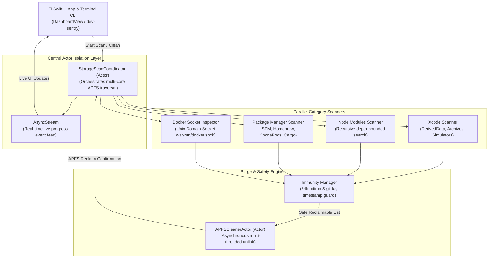

# ARCHITECTURE.md — DevSentry Architecture

> Storage scanning engines, APFS low-level I/O, safety immunity rules, and UI taxonomy for DevSentry.

---

## 🏗️ 1. High-Level Scanner Architecture



---

## ⚡ 2. Actor Concurrency & Progress Streaming

To keep the UI running at locked 60 FPS while traversing hundreds of thousands of files across an SSD:

```swift
import Foundation

public struct ScanProgress: Sendable {
    public let currentCategory: String
    public let scannedBytes: Int64
    public let filesDiscovered: Int
    public let isComplete: Bool
}

public actor StorageScanCoordinator {
    private var isScanning = false
    
    public func startScan() -> AsyncStream<ScanProgress> {
        AsyncStream { continuation in
            Task.detached(priority: .userInitiated) {
                var totalBytes: Int64 = 0
                var totalFiles = 0
                
                // 1. Scan Xcode DerivedData
                continuation.yield(ScanProgress(
                    currentCategory: "Xcode DerivedData",
                    scannedBytes: totalBytes,
                    filesDiscovered: totalFiles,
                    isComplete: false
                ))
                let xcodeResult = await XcodeScanner.scan()
                totalBytes += xcodeResult.totalBytes
                totalFiles += xcodeResult.itemCount
                
                // 2. Scan Inactive node_modules
                continuation.yield(ScanProgress(
                    currentCategory: "Node Modules",
                    scannedBytes: totalBytes,
                    filesDiscovered: totalFiles,
                    isComplete: false
                ))
                let nodeResult = await NodeModulesScanner.scan()
                totalBytes += nodeResult.totalBytes
                totalFiles += nodeResult.itemCount
                
                // Complete
                continuation.yield(ScanProgress(
                    currentCategory: "Complete",
                    scannedBytes: totalBytes,
                    filesDiscovered: totalFiles,
                    isComplete: true
                ))
                continuation.finish()
            }
        }
    }
}
```

---

## 🗑️ 3. APFS Fast Asynchronous Unlink Engine

Standard `FileManager.default.removeItem(at:)` on macOS can block the calling thread for 10–30 seconds when removing a 30GB `DerivedData` directory containing 200,000 files.

### High-Speed APFS Unlink Strategy:
1. **Directory Relocation**: Instantly moves the target directory to a temporary scratch path on the same APFS volume (`NSTemporaryDirectory()`) via atomic `rename(2)`. This makes the target directory disappear from the developer's view in $< 5\text{ms}$.
2. **Background Multi-Threaded Unlink**: A detached POSIX worker thread asynchronously unlinks the scratch directory using low-level `removefile(3)` with `REMOVEFILE_RECURSIVE` flags without UI hitches.
